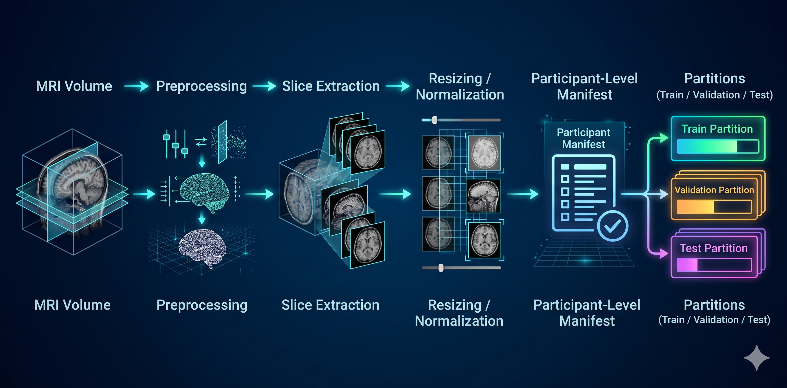
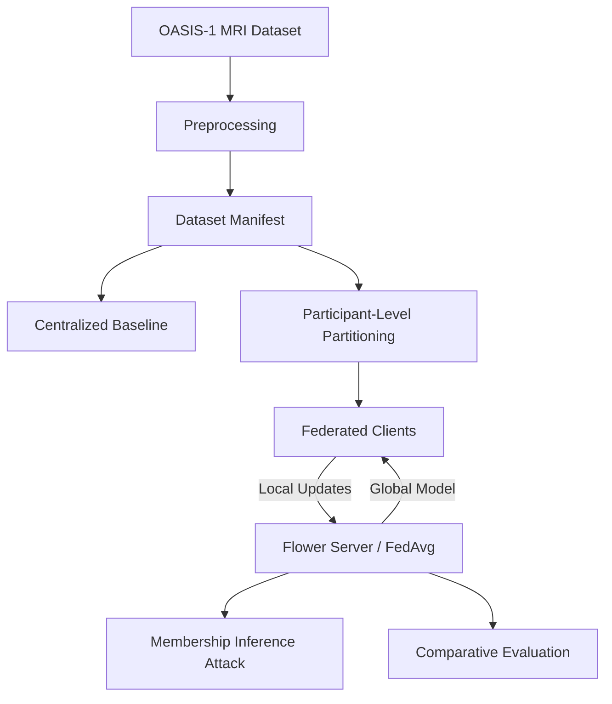
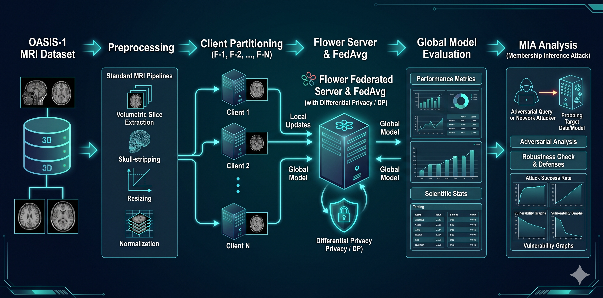

# FedCortex
### Privacy-Preserving Federated Learning for Alzheimer's Disease Classification Using Brain MRI

This project explores the intersection of **Federated Learning (FL)**, **Differential Privacy (DP)**, and **Membership Inference Attacks (MIA)** for brain MRI classification, specifically targeting the Alzheimer's Disease (AD) classification task using the OASIS-1 dataset.

---

## 1. Abstract
**FedCortex** provides a reproducible research framework for training deep learning models on distributed medical MRI datasets while ensuring privacy and evaluating vulnerability to membership inference attacks. We benchmark:
- **Centralized training** (baseline)
- **Federated learning (FedAvg)** (distributed training)
- **Differential privacy (DP-SGD)** (privacy-preserving training)

We evaluate the privacy–utility trade-off using a participant-level threat model, demonstrating that while federated learning reduces the membership leakage compared to a centralized baseline, it does not eliminate it.

---

## 2. Research Problem and Motivation
Centralized medical-data collection faces significant hurdles due to data-privacy regulations, administrative burdens, and patient-data ownership. Federated learning allows training models on decentralized data without moving sensitive MRI volumes. However, federated models may still leak information about their training participants through their parameters or output distributions. This project investigates these privacy risks, focusing on:
- How federated training impacts membership inference risk.
- The utility cost of differential privacy in the federated setting.
- Participant-level data leakage assessment.

*Note: This repository is intended for academic and research purposes. It is not a clinically validated diagnostic system and must not be used as a substitute for professional medical assessment.*

---

## 3. Dataset Documentation
The project uses the **OASIS-1** dataset, which consists of T1-weighted brain MRI volumes of participants with varying levels of cognitive decline.
- **Classification Task**: Cognitively Normal (CN) vs. CDR-positive.
- **Data Pipeline**:
  - Raw T1-weighted MRI volumes (Analyze/NIfTI).
  - Slice extraction (7 fixed axial slices).
  - Normalization (percentile clipping + scaling to [0,1]).

---

## 4. System Architecture
The following diagram illustrates the overall system architecture:

---

## 5. Technical Stack

| Library | Purpose |
|---|---|
| Python | Core language |
| PyTorch | Model definition and training |
| Flower (flwr) | Federated learning framework |
| Opacus | Differential privacy engine |
| NiBabel | MRI processing |
| Scikit-learn | MIA and evaluation metrics |
| Matplotlib/Seaborn | Visualization |

---

## 6. Installation and Setup
1. **Clone the repository**: `git clone <repository-url>`
2. **Setup virtual environment**: `python -m venv .venv && source .venv/bin/activate`
3. **Install dependencies**: `pip install -r requirements.txt`
4. **Prepare Dataset**: Place OASIS-1 archives in `data/raw/archives/` and run `python preprocessing/extract_mri_dataset.py`.
5. **Run Preprocessing**: `python preprocessing/build_slice_manifest.py`.
6. **Execute Experiments**:
   - Centralized: `python experiments/train_centralized.py`
   - Federated: `python federated/run_federated.py`
   - Privacy: `python privacy/membership_inference.py`

---

## 7. Experimental Results
*Experimental results, including accuracy, ROC-AUC, and privacy-accounting metrics, are available in the `results/` directory.*

<!--
IMAGE PLACEHOLDER:
- centralized-training-history.png
- confusion-matrix.png
- centralized-roc-curve.png
- federated-client-distribution.png
- dp-privacy-utility.png
- mia-comparison.png
-->

---

## 8. License and Disclaimer
*This repository is intended for academic and research purposes only. Refer to the project's license file for usage conditions.*
